# ArtLayerr

> **Renamed:** ArtLayerr was previously called Layerr. If you installed the old image
> (`ghcr.io/minimaxpower/layerr`), switch to `ghcr.io/minimaxpower/artlayerr`: the old one no longer receives updates.

A web UI that lets you scroll through the images that Plex provides for each item (movie, show, season, episode, background, logo, square) and pick the one you want with a single click.

When you click on an image, it is downloaded to a dedicated `assets` directory with the correct pathing and naming for Kometa.

You have to fill in the `.env` file for it to work.

## Requirements

- A Plex Media Server reachable from the machine running ArtLayerr
- Your [Plex token](https://support.plex.tv/articles/204059436-finding-an-authentication-token-x-plex-token/)
- Docker with Docker Compose (on Synology: Container Manager)
- The folder where Kometa reads its assets, so ArtLayerr can write images there

## Installation (Docker Compose, recommended)

1. Create a folder for ArtLayerr and go into it:
   ```
   mkdir artlayerr && cd artlayerr
   ```

2. Create a `docker-compose.yml`:
   ```yaml
   services:
     artlayerr:
       image: ghcr.io/minimaxpower/artlayerr:latest
       container_name: artlayerr
       restart: unless-stopped
       init: true
       ports:
         - "3535:5000"
       volumes:
         - ${ASSETS_DIR}:/assets
       environment:
         - PLEX_BASE_URL=${PLEX_BASE_URL}
         - PLEX_TOKEN=${PLEX_TOKEN}
         - KOMETA_ASSET_DIR=/assets
         - SECRET_KEY=${SECRET_KEY}
         - APP_PASSWORD=${APP_PASSWORD:-}
         - DISABLE_UPDATE_CHECK=${DISABLE_UPDATE_CHECK:-}
         - AUTO_REFRESH_HOURS=${AUTO_REFRESH_HOURS:-}
         - ASSETS_DEPTH=${ASSETS_DEPTH:-}
         - ITEMS_CACHE_SECONDS=${ITEMS_CACHE_SECONDS:-}
   ```

3. Create a `.env` file next to it (you can start from [`.env.example`](.env.example)):
   ```
   PLEX_BASE_URL=http://YOUR_PLEX_IP:32400
   PLEX_TOKEN=YOUR_PLEX_TOKEN
   SECRET_KEY=RANDOM_SECRET_KEY_OF_YOUR_CHOICE
   ASSETS_DIR=/path/to/your/assets
   APP_PASSWORD=
   DISABLE_UPDATE_CHECK=
   AUTO_REFRESH_HOURS=
   ASSETS_DEPTH=
   ITEMS_CACHE_SECONDS=
   ```

   | Variable | Description |
   |---|---|
   | `PLEX_BASE_URL` | Address of your Plex server, e.g. `http://192.168.1.10:32400` |
   | `PLEX_TOKEN` | Your Plex authentication token |
   | `SECRET_KEY` | Any long random string (generate one with `openssl rand -base64 32`) |
   | `ASSETS_DIR` | Host folder where images are saved (your Kometa assets directory) |
   | `APP_PASSWORD` | *Optional.* If set, the whole app asks for this password. Leave empty to disable (default) |
   | `DISABLE_UPDATE_CHECK` | *Optional.* The "new version available" badge relies on a check against GitHub (at most one request every 6 hours). Set to `1` (or `true`) to turn it off. Empty, unset or `0` keeps it on (default) |
   | `AUTO_REFRESH_HOURS` | *Optional.* Recompute the dashboard and re-scan the assets folder automatically every X hours (for example `6`), at most every 15 minutes. Empty or `0` = off, the **Update** buttons stay the only trigger (default). Needs `PLEX_BASE_URL` and `PLEX_TOKEN` to be set in `.env` |
   | `ITEMS_CACHE_SECONDS` | *Optional.* How long, in seconds, the list of titles of a library is kept in memory before Plex is asked again. Listing a whole library is the slowest thing ArtLayerr does, so on big libraries this makes pages and navigation much faster. Empty = `300` (5 minutes); `0` turns the cache off. The dashboard refresh fills it, and the **Update** button of a library empties it, so titles added to or removed from Plex show up right after an Update, or after this delay. The titles are kept in memory (a few MB per thousand titles) |
   | `ASSETS_DEPTH` | *Optional.* How many folder levels below `ASSETS_DIR` are searched for asset folders. Empty = `2` (default), which covers every layout listed below. Set `3` if your asset folders are nested one level deeper, for example `assets/<Library>/<Group>/<Title>/` |

   ArtLayerr finds your existing assets whatever the layout of the assets folder, as long as each item has its own folder containing `poster.jpg`, `background.jpg`, `logo.png`, `square.png`, `Season01.jpg` or `S01E01.jpg`:

   ```
   assets/movies/<Title>/poster.jpg                      # ArtLayerr's own layout
   assets/series/<Title>/poster.jpg
   assets/<Library>/<Title (Year) {tmdb-123}>/poster.jpg  # Kometa, one folder per Plex library
   assets/<Title (Year) {tvdb-123}>/poster.jpg            # everything in one folder
   ```

   An asset folder is matched to a Plex item by (in this order) the name of the item's folder in Plex, the TMDB / TVDB / IMDB id written in the asset folder name (`{tmdb-123}`, `{tvdb-123}`, `{imdb-tt123}` or `[tmdbid-123]`), then `Title (Year)`. Folders starting with `.`, `@` or `#` (for example Synology's `@eaDir`) are ignored. New images go into the folder that already exists for the item; if there is none, into `assets/movies` / `assets/series` when they exist, otherwise into the folder named after the item's Plex library (`assets/<Library>/`). After changing the layout, or upgrading, click **Update** once so the assets folder is scanned again.

4. Start it:
   ```
   docker compose up -d
   ```

5. Open `http://YOUR_SERVER_IP:3535`.

> **Exposing ArtLayerr on the Internet?** Set `APP_PASSWORD`, use a long random `SECRET_KEY` (the session cookie is signed with it) and put the app behind an HTTPS reverse proxy, otherwise the password travels in clear text.

To update to a newer version:

```
docker compose pull
docker compose up -d
```

### Synology (Container Manager)

1. Copy `docker-compose.yml` and `.env` to a folder on your NAS (for example `/volume1/docker/artlayerr`).
2. In Container Manager, go to **Project → Create**, choose that folder as the path, and select "Use existing docker-compose.yml".
3. Start the project, then open `http://YOUR_NAS_IP:3535`.

## Usage

The connection page should be filled in automatically if you completed the `.env` correctly:

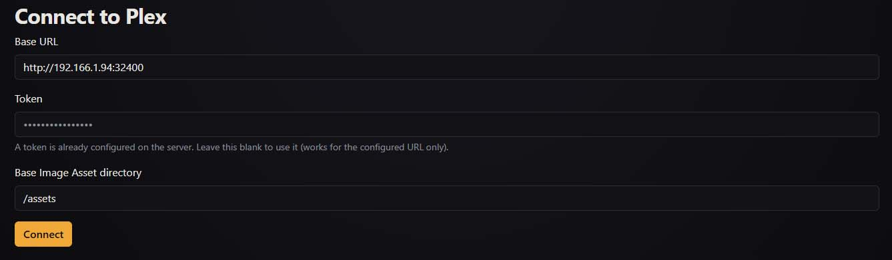

After that you'll access the dashboard with every library of your Plex server. To begin with, I recommend you click the update button, especially if you already have some files in the assets directory.

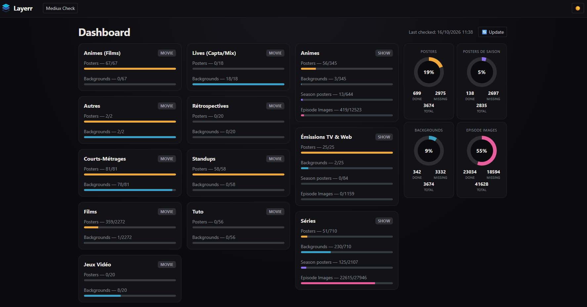

The dashboard numbers (library bars and rings) also move by themselves right after you download, upload or paste an image: the new file is counted at once, without waiting for **Update**. **Update** is still what picks up titles added to or removed from Plex, and changes made in the assets folder by something else (Kometa, a manual copy…).


Then you can click on any library you want:
You'll see a grid displaying all the movies of that library.
You also get a visual indication of whether a movie already has a poster/background selected in the Kometa assets directory.

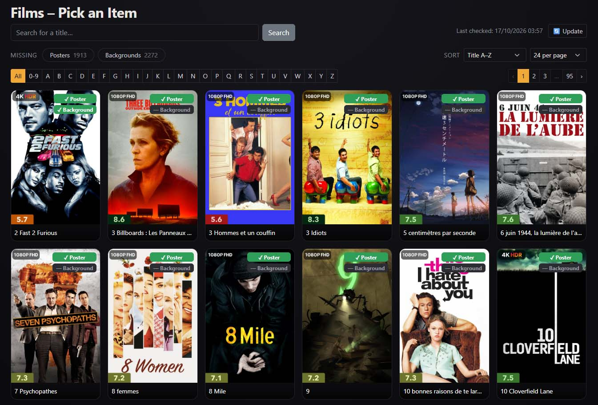

A small badge next to the title tells where the poster lives: **Plex** (only on Plex, nothing in the assets folder yet), **Assets** (a file in the assets folder that Plex does not have yet, because Kometa has not run since) or **Both** (this exact file has been sent to Plex). It is checked for real: when Kometa applies an asset it uploads the file to Plex, which keeps it in the item's list of images under a key ending with the file's SHA-1, so ArtLayerr compares the file's SHA-1 with that list. This also works for files applied long ago, with no need to download them again. The first time, cards show "…" and are checked in the background, three at a time, without slowing the page; the result is remembered in a small `.artlayerr-applied.json` file next to the state file and only redone when the file changes or Plex changes the item.

You can also search by name, or only filter by movies missing a poster/background:

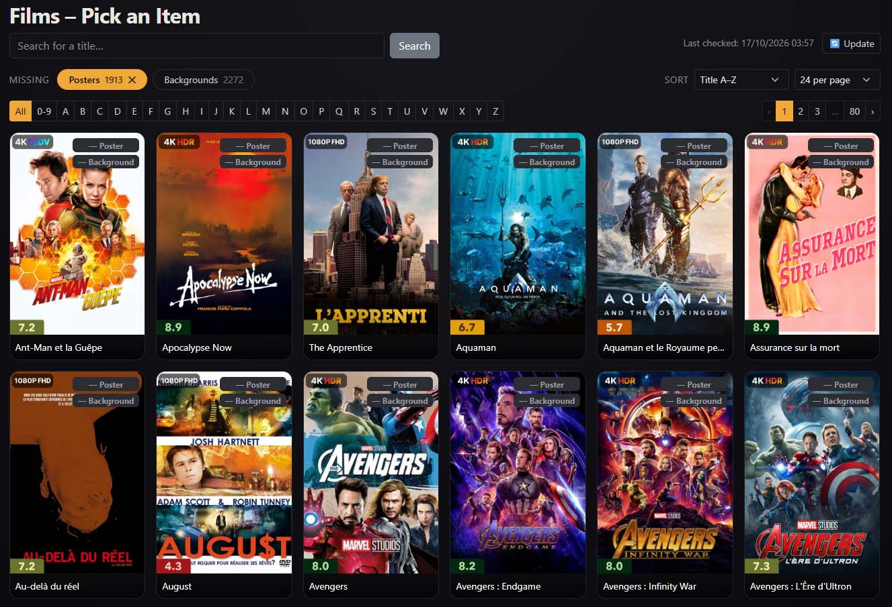

A second row of chips, **Has**, does the opposite of **Missing**: it lists only the items that already have a poster, a background (and a logo or square art when switched on). For shows, *Seasons* and *Episodes* keep the shows that have at least one season poster / episode image, so a partly covered show appears under both **Has** and **Missing**. Previous / Next on the item page stay within the filtered list.

If you click on a movie, you'll see a grid displaying all the posters available on Plex for that movie (you can also download one from a URL or import one from your computer):

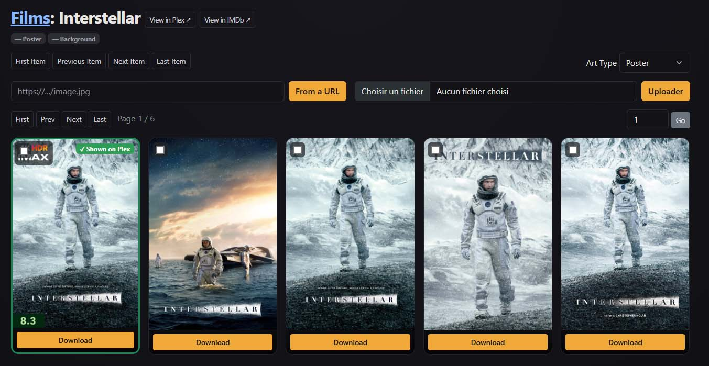

Above the images, since [**v2.6.0**](https://github.com/Minimaxpower/ArtLayerr/releases#release-v2.6.0), a panel shows side by side what Plex currently shows and what is in the assets folder for the image you are browsing (show, season or episode level), with the file name and date, and the same Plex / Assets / Both status, checked with the file's SHA-1. With Kometa overlays, Plex shows a later upload (the image with the overlay drawn on it), so the panel then says the file was sent to Plex but is not the one currently shown. It also works for logos and square.

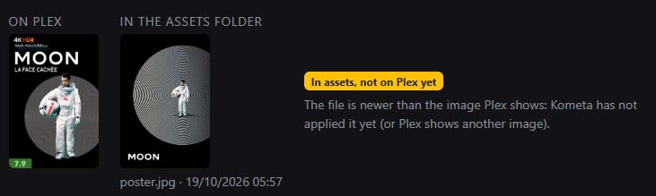

You can choose to view backgrounds instead of posters:

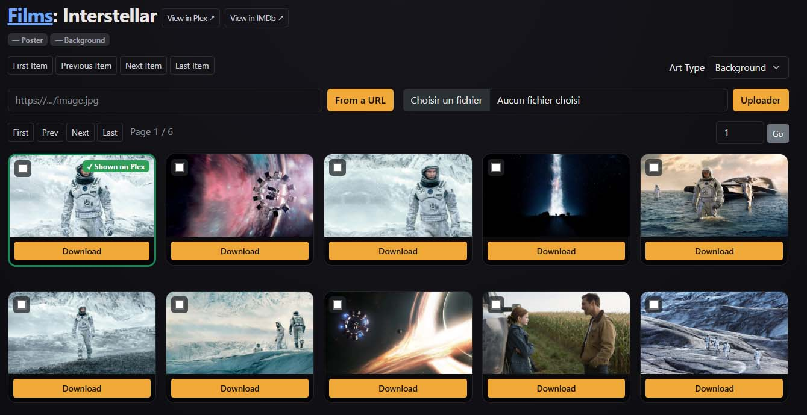

When you click the Download button, the file is downloaded to the assets directory, and a flash message reports the path:

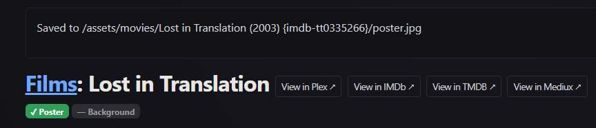

Clicking the title/logo in the upper left takes you back to the libraries dashboard.
Clicking the library name brings you back to the items list of that library.

In a Show library, you'll see a grid displaying all the shows of that library.
You also get a visual indication of whether a show already has a poster/background/seasons/episodes selected in the Kometa assets directory

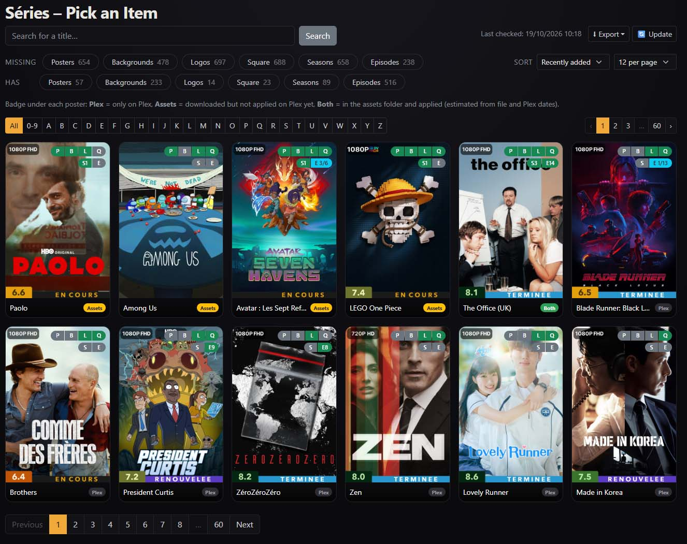

You can also search by name, or only filter by shows missing a poster/background/seasons/episodes:
Green indicates you have everything (for example all seasons and all episodes). Blue indicates that you're missing some. A good way to keep visual track of what is incomplete!

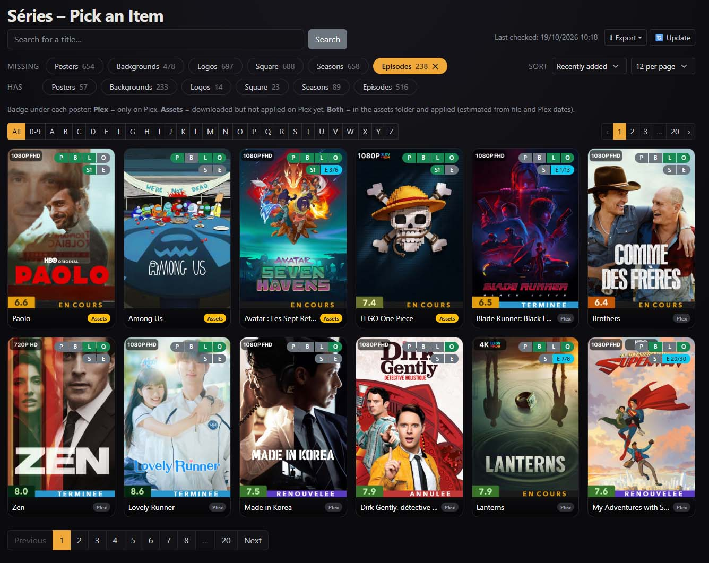

Each card carries colored chips: `P` poster, `B` background, `L` logo and `Q` square (these two only when switched on, see below), then `S` seasons (season posters) and `E` episodes (episode images) for shows. Green means complete, blue partial (for example `S 3/5`), gray missing, and light gray not checked yet. Hover a chip for the detail.

If you click on a show, you'll get the same kind of grid as for movies:

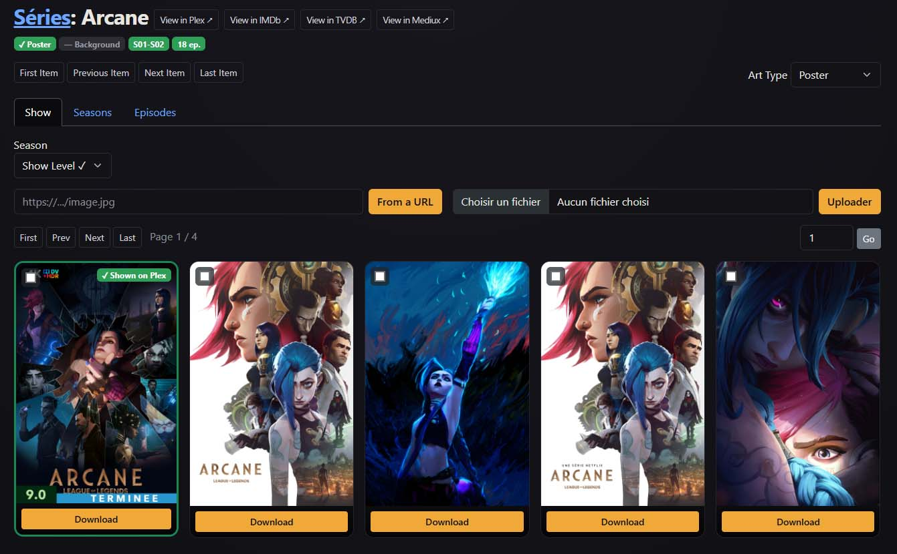

With more options, as you can also access seasons:

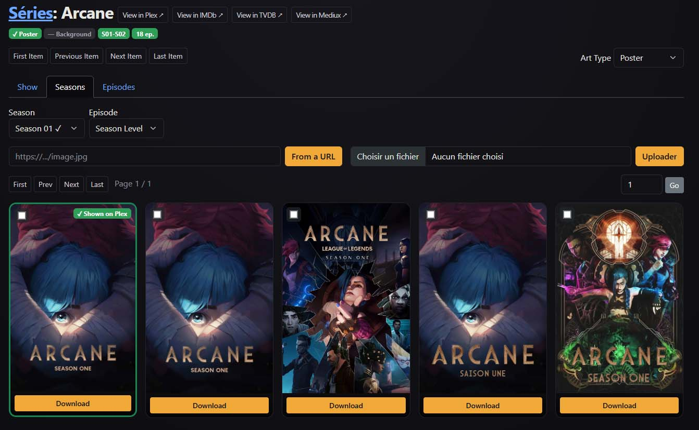

And episodes:

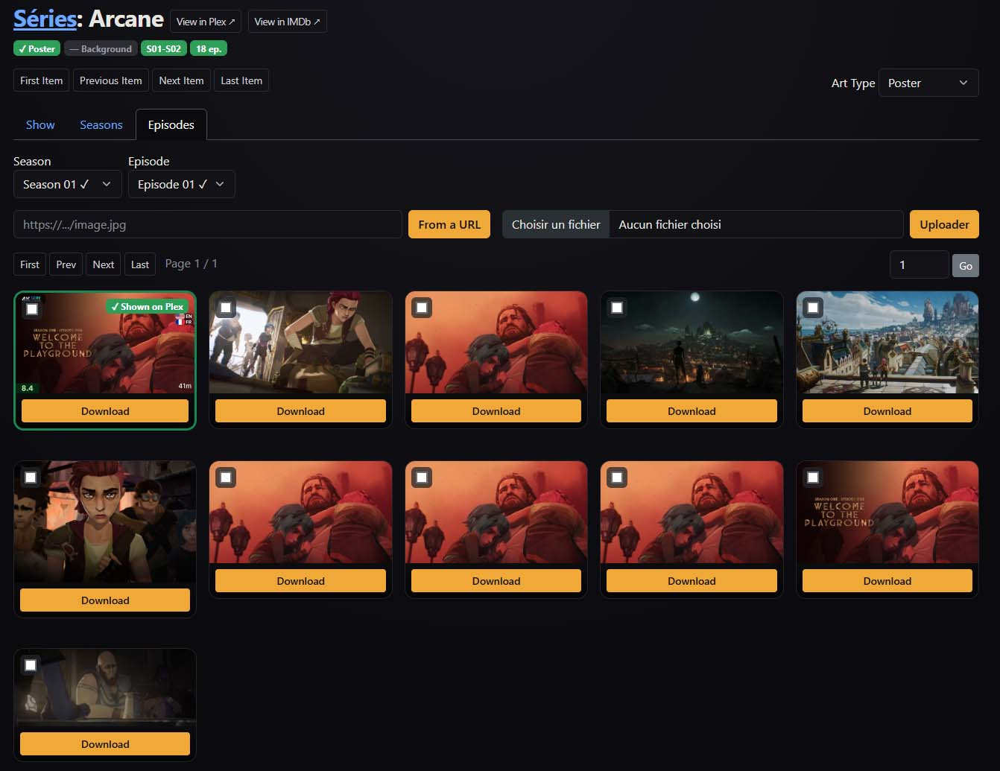

You can also select multiple images and compare them :

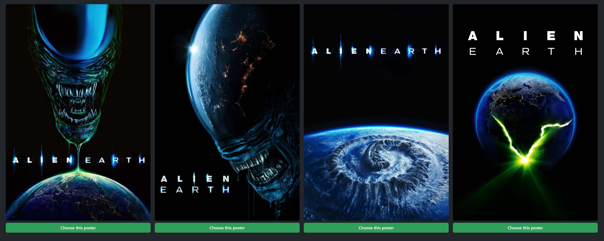

Once a check has been run, the **Export** button (on the dashboard, and on each library's list) downloads what is missing as a CSV file (one row per item, with TMDB/TVDB/IMDB ids and the asset folder name) or as a plain text list. On a library's list it exports the whole library for the current filter; on the dashboard it exports every library.

The four rings on Library Dashboard (posters, seasons, backgrounds, episodes) are now links to what is missing. If only one library concerned: opens its filtered list directly; several: a small picker.

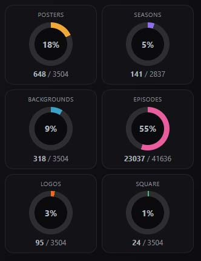

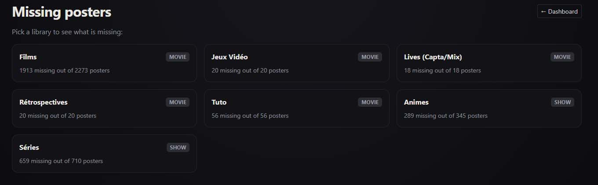

The **Settings** menu (top right) gathers the display options:
- **Show logos / Show square**: logos (`logo.png`) and square (`square.png`) are optional, so they are hidden by default. Switching them on adds an `L` / `Q` chip to every card, an extra entry in the "Art Type" list of the image picker, two more rings on the dashboard, a filter, and columns in the exports. The choice is kept in your browser; everything is scanned either way, so no new check is needed (apart from one **Update** after upgrading).
- **Color mode**: *Default*, *Red-green colorblind* (Okabe-Ito palette) or *Blue-yellow colorblind*. It changes the colors of the dashboard bars and rings and of the "complete / partial" chips and badges.
- **Visual cues**: *None*, *Icons* (a small symbol per art type on the dashboard, and ✓ / ◐ / ✕ on the status chips) or *Patterns* (each art type gets its own hatching on the bars and rings, and partial / missing chips get a texture). Cues work with any color mode, so color is never the only signal. Like the other display options, both choices are kept in your browser.
- **Language**: *English* or *Français* (see [Translations](#translations)). It is a display choice kept in your browser; English is the default and nothing switches on its own.
- Light / dark mode, and **Log out** when a password is set.

Libraries you don't want to count (a test library, a kids' library…) can be left out of the dashboard totals: click the eye icon on the library's card (open eye = counted, crossed-out eye = ignored). It stays visible, greyed out, and you can still open it; click the eye again to count it. Ignored libraries are also left out of the rings' pickers and of the dashboard export. The choice is saved on the server.

The **search box** in the top bar (press `/` on any page to jump to it) searches the titles of all your movie and show libraries at once, ignoring case and accents (`amelie` finds *Amélie*) and matching the original title and the year too (`dark 2017`). Results are grouped by library, with the same P / B (and L / Q) chips as the lists, and open the item page. It uses the libraries already loaded in memory (see `ITEMS_CACHE_SECONDS`), so after a restart the first search loads every library from Plex and can take a moment. It shows at most 120 titles, shared between the libraries.

If you click on Mediux Check, you can select one or more [Mediux](https://mediux.pro) files to compare them with your library and see if you're missing anything.

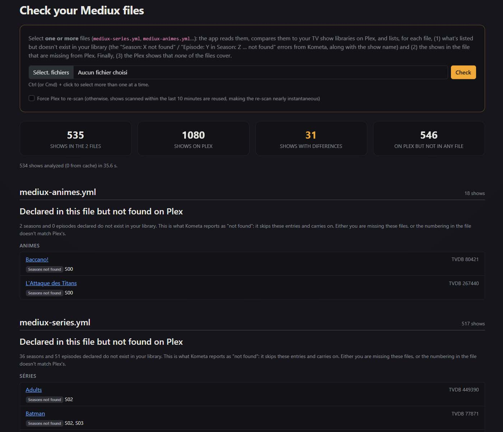

## Translations

The interface is available in English (default) and French; pick the language in **Settings → Language**. Dates in the browser follow the chosen language. The CSV / text exports always keep English column names, so they stay easy to script.

Translations are plain [gettext](https://www.gnu.org/software/gettext/) files in `translations/` (`fr.po`), read when ArtLayerr starts: no compilation step and no extra dependency. A language shows up in the picker as soon as its `.po` file exists. A text missing from a language simply appears in English.

To add or fix a language:

1. Copy `translations/messages.pot` to `translations/<code>.po` (for example `de.po`) and fill in the header (`Language`, `Plural-Forms`, and `X-Native-Name`, the name shown in the picker, for example `Deutsch`).
2. Translate the `msgstr` lines with any text editor, [Poedit](https://poedit.net) or Weblate. Keep the `%(name)s` placeholders and the HTML tags (`<strong>`…) as they are in the original.
3. Run `python tools/translations.py check`: it lists the texts that are missing, and the placeholders or tags that differ from the English text.

After the code changes (new or edited texts), `python tools/translations.py pot` rebuilds the template and `python tools/translations.py sync` adds the new texts to every `.po` file, ready to translate.

## Credits

ArtLayerr started as a fork of [Plex Image Picker](https://github.com/chazlarson/Media-Scripts/tree/main/Plex%20Image%20Picker)
by chazlarson and has since been heavily modified.

## License

MIT, see [LICENSE](LICENSE).
